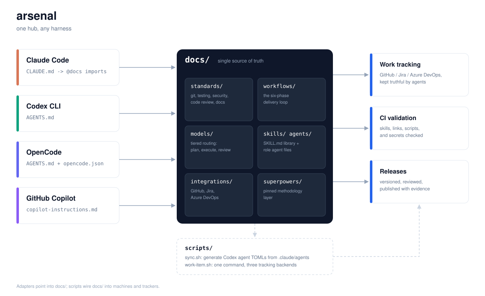

# arsenal

**One shared hub for every AI coding agent on your team.**

Arsenal is a template repository that centralizes agent skills, engineering
standards, model routing, and work tracking in one repository that
Claude Code, Codex CLI, OpenCode, and GitHub Copilot all read. Clone it once,
point every harness at it, and stop re-teaching each tool how your team works.



## The problem it solves

Teams adopt AI coding agents piecemeal. Each harness brings its own config
file, its own skill format, and its own habits. Within a quarter you have
four half-overlapping rulebooks, model spend nobody planned, tests the agents
quietly stopped running, and work tracked in whatever tool the loudest
engineer prefers. The agents are not the problem. The missing shared
infrastructure is.

Arsenal is that infrastructure:

- **One source of truth.** Standards, workflows, and model policy live in
  `docs/`; skills live in `.agents/skills/` and role agents in
  `.claude/agents/`. Root-level adapter files (`AGENTS.md`, `CLAUDE.md`,
  `.github/copilot-instructions.md`, `opencode.json`) point every harness
  at it.
  Guidance is written once and read everywhere.
- **A delivery loop with gates.** Research, plan, execute, verify, track,
  publish. Each phase has entry criteria, a defined owner (human or agent
  tier), and a gate. Code does not move forward through a red test suite.
- **Model routing by tier.** Strategist models plan and review. Executor models
  write code. The policy and the per-harness wiring live in
  [`docs/models/routing.md`](docs/models/routing.md), so the expensive models
  spend their tokens where they change outcomes.
- **Work tracking that follows the work.** One command,
  `scripts/work-item.sh`, creates and updates work items in GitHub Issues,
  Jira, or Azure DevOps. Agents stamp the IDs; the tracker stays truthful.
- **The Superpowers methodology, pinned.** The open-source Superpowers skill
  library (brainstorm, plan, TDD, subagent development) is installed per
  harness from a pinned version recorded in [`docs/superpowers/`](docs/superpowers/README.md).
- **Validated by CI.** Skill frontmatter, internal links, shell scripts, and
  the tracking script's own tests are checked on every push, so the hub
  cannot rot quietly.

## Harness support

| Harness | Entry file | Skills wiring | Guide |
| --- | --- | --- | --- |
| Claude Code | `CLAUDE.md` (imports `docs/`) | `.agents/skills` via the committed plugin in `.claude-plugin/` | [`docs/harness/claude-code.md`](docs/harness/claude-code.md) |
| Codex CLI | `AGENTS.md` | `.agents/skills` (native) | [`docs/harness/codex.md`](docs/harness/codex.md) |
| OpenCode | `AGENTS.md` + `opencode.json` | `.agents/skills` (native) | [`docs/harness/opencode.md`](docs/harness/opencode.md) |
| GitHub Copilot | `.github/copilot-instructions.md` (+ `AGENTS.md` for the coding agent) | `.agents/skills` (native) | [`docs/harness/copilot.md`](docs/harness/copilot.md) |

Skills and role agents live once, in real folders: `.agents/skills/` (the
cross-tool standard location) and `.claude/agents/`. Codex, Copilot, and
OpenCode read the skills there natively; Claude Code reads them through a
small committed plugin (`.claude-plugin/`, `.claude/settings.json`) that
points at the same folder. Claude Code and Copilot read the agents
natively, OpenCode through `opencode.json` pointers, and Codex from TOML in
`.codex/agents/` that `scripts/sync.sh` generates and CI checks for drift.
No symlinks and no copies, so a clone works the same on macOS, Linux, and
Windows with no setup.

Any harness that reads `AGENTS.md` or the Agent Skills standard works with the
same pattern. `docs/harness/README.md` shows how to add the next one.

## Adopting the template

Skills and agents work from the clone: they are plain committed folders, so
there is nothing to install (Claude Code asks once to trust the folder,
which enables its plugin). The checklist:

1. Create your repo from this template (green "Use this template" button)
   or `git clone https://github.com/Alex5350/arsenal.git your-repo`.
2. Run `scripts/adopt.sh <project-name>` (`--dry-run` previews). It renames
   `arsenal` to your name in the three Claude Code plugin files, so two
   projects on one machine never share a plugin registration, and copies
   the starters that are not there yet: `docs/templates/app-ci.yml` to
   `.github/workflows/app.yml` and `docs/templates/work-item.example.env`
   to `.env`. It also replaces arsenal's own `AGENTS.md` with
   `docs/templates/AGENTS.example.md` (a consumer-written `AGENTS.md` is
   left alone); fill in the placeholders.
3. Implement `make test-unit` and `make test-integration` for your stack;
   the inherited Makefile defines them for the hub's own checks, so replace
   or extend those recipes ([testing standard](docs/standards/testing.md)).
4. Pick a tracker in `.env` (`WORK_BACKEND=gh|jira|ado`). On GitHub, set
   `GH_REPO` or leave it unset and the script reads the `origin` remote.
5. Install Superpowers in each harness you use, per the pinned matrix in
   [`docs/superpowers/`](docs/superpowers/README.md).
6. `make verify`, then open the repo in any harness and start with
   "Read AGENTS.md and begin."

Optional: `scripts/bootstrap.sh --user` makes the skills available in your
other projects too (`--dry-run` to preview, `--remove` to undo).

Humans should start at [`docs/README.md`](docs/README.md). Deep design notes
live in [`TECHNICAL.md`](TECHNICAL.md), and terminology in
[`GLOSSARY.md`](GLOSSARY.md).

## The delivery loop


Six phases, each with a gate. Strategist models own research and planning,
executor models own implementation, and the reviewer tier owns verification
evidence. Full definitions in [`docs/workflows/`](docs/workflows/README.md).

## What is inside

```
docs/
  README.md          hub map and reading order
  ARCHITECTURE.md    how the hub is wired, and why
  harness/           per-harness adapter guides (4 + how to add more)
  standards/         git, testing, security, code review, documentation
  workflows/         the six-phase delivery loop, phase by phase
  models/            tiered model routing policy and per-harness wiring
  skills/            skill authoring rules (library in .agents/skills/)
  agents/            role agent contract (agents in .claude/agents/)
  integrations/      GitHub Issues, Jira, Azure DevOps
  superpowers/       pinned Superpowers methodology layer
  templates/         starter CI and release workflows, tracking config, AGENTS.md
scripts/
  adopt.sh           rename the plugin and copy the starters into a new repo
  sync.sh            generate the Codex agent TOMLs (--check in CI)
  bootstrap.sh       optional: wire skills into your other projects
  work-item.sh       one command, three tracking backends (tests in tests/)
  validate-skills.sh SKILL.md frontmatter linter (CI)
  validate-manifests.sh  plugin, marketplace, settings, opencode.json checker (CI)
  check-links.sh     internal markdown link checker (CI)
tests/               stubbed-CLI tests for work-item.sh (make test-unit)
```

## Built on open standards

Arsenal commits to the three standards the industry converged on rather than
to any vendor:

- [AGENTS.md](https://agents.md) for tool-agnostic instructions
- [Agent Skills](https://agentskills.io) (`SKILL.md`) for portable procedural knowledge
- [MCP](https://modelcontextprotocol.io) for tool and data connections

When a harness changes, the adapter changes. The hub does not.

## License and attribution

MIT. See [LICENSE](LICENSE). The [Superpowers](https://github.com/obra/superpowers)
skill library it installs is MIT work by Jesse Vincent and contributors;
arsenal references and pins it but does not redistribute it.
