# Harness guides

How each harness consumes this hub. Every guide answers the same five
questions: what it reads first, how skills reach it, how model tiers are
wired, how it runs the gates, and its quirks.

| Harness | Reads first | Skills arrive via | Guide |
| --- | --- | --- | --- |
| Claude Code | `CLAUDE.md` (@imports), `AGENTS.md` fallback | `.agents/skills` through the committed plugin (`.claude-plugin/`) | [claude-code.md](claude-code.md) |
| Codex CLI | `AGENTS.md` | `.agents/skills` (native) | [codex.md](codex.md) |
| OpenCode | `AGENTS.md` + `opencode.json` | `.agents/skills` (native) | [opencode.md](opencode.md) |
| GitHub Copilot | `.github/copilot-instructions.md`; coding agent reads `AGENTS.md` | `.agents/skills` (native) | [copilot.md](copilot.md) |

The [skills library](../skills/README.md) lives in `.agents/skills`, the
cross-tool folder, once. Codex, Copilot, and OpenCode read it natively.
Claude Code is the one harness that does not, so a committed repo-local
plugin (`.claude-plugin/plugin.json`, `.claude-plugin/marketplace.json`,
`.claude/settings.json`) points it at the same folder. No symlinks, no
copies, zero setup after clone, on any OS.

## Role agents

The [role agents](../agents/README.md) (researcher, planner, reviewer) are
defined once in `.claude/agents/`:

| Harness | Agents directory | Mechanism |
| --- | --- | --- |
| Claude Code | `.claude/agents/<name>.md` | canonical, native |
| Copilot (CLI, VS Code) | `.claude/agents/<name>.md` | canonical, native |
| OpenCode | `.claude/agents/<name>.md` | `opencode.json` subagent with a `{file:}` prompt pointer |
| Codex CLI | `.codex/agents/<name>.toml` | generated TOML (committed, `scripts/sync.sh`) |

Facts in these guides that depend on vendor behavior carry a
`Last verified: YYYY-MM` line. When a harness updates, fix the guide, not
the hub.

## Adding the next harness

Any tool that reads `AGENTS.md` or the [Agent Skills](https://agentskills.io)
standard works with the same three steps:

1. **Entry**: prefer `AGENTS.md` (already at the root). If the tool wants
   its own file, add a root adapter that points at `docs/README.md` and
   carries no guidance of its own.
2. **Skills and agents**: if the tool reads `.agents/skills` (and
   `.claude/agents` for agents) natively, nothing is needed; confirm the
   tool lists them. Otherwise bridge with a committed config file that
   points at the canonical folder (the way `.claude-plugin/` does for Claude
   Code and `opencode.json` does for OpenCode agents), and confirm the tool
   lists them. Generate a file only when the tool's format forces it (Codex
   agents are TOML); then it goes in `scripts/sync.sh` and CI checks it.
   Never add a symlink or a copy.
3. **Guide**: add `docs/harness/<tool>.md` answering the same five
   questions, update the matrix above, and link it from the root README.

## AI resource sharing

[View the self-contained SVG](../assets/ai-resources-sharing.svg) (readable at
1000px wide). Repository sharing uses **zero symlinks and zero skill copies**.
Read arrows point to their inputs; the generated-file arrow points to its output.
Entry-file pointer details appear inside the instruction nodes.

```mermaid
flowchart TB
  subgraph S["Skills — one canonical folder"]
    direction LR
    SC["Claude Code (.claude)"] -->|native read| P["Committed plugin bridge<br/>.claude/settings.json<br/>.claude-plugin/marketplace.json<br/>.claude-plugin/plugin.json"]
    P -.->|committed config pointer| SK["Canonical skills<br/>.agents/skills"]
    SX["Codex CLI (.codex)"] -->|native read| SK
    SG["Copilot (.github)"] -->|native read| SK
    SO["OpenCode"] -->|native read| SK
  end
  subgraph A["Role agents — one canonical Markdown source"]
    direction LR
    AC["Claude Code (.claude)"] -->|native read| AG["Canonical agents<br/>.claude/agents/&lt;name&gt;.md"]
    AP["Copilot (CLI + VS Code)"] -->|native read| AG
    AO["OpenCode"] -->|native read| OP["opencode.json<br/>prompt: {file:./.claude/agents/&lt;name&gt;.md}"]
    OP -.->|committed config pointer| AG
    AX["Codex CLI (.codex)"] -->|native read| TOML[".codex/agents/*.toml<br/>Committed output; trusted projects"]
    AG ==>|generated file: scripts/sync.sh| TOML
  end
  subgraph I["Instructions — entry files and their pointers"]
    direction LR
    IC["Claude Code"] -->|native read| CM["CLAUDE.md<br/>@imports docs/README.md + docs/harness/claude-code.md"]
    IU["Codex CLI + OpenCode<br/>Copilot coding agent<br/>Claude Code (fallback if CLAUDE.md is absent)"] -->|native read| AM["AGENTS.md<br/>Universal entry"]
    IG["Copilot (VS Code)"] -->|native read| CI[".github/copilot-instructions.md<br/>Defers to AGENTS.md and docs/"]
    IO["OpenCode"] -->|native read| OI["opencode.json instructions<br/>Merges docs/README.md into instructions"]
  end
  N["Repository sharing: zero symlinks and zero skill copies<br/>Optional user-level bootstrap links are outside this view"]
  classDef canonical fill:#eaf5ef,stroke:#478568,color:#182c3c;
  classDef config fill:#f3effa,stroke:#9b8ab7,color:#182c3c;
  classDef generated fill:#fff3e7,stroke:#bb8759,color:#182c3c;
  class SK,AG canonical;
  class P,OP config;
  class TOML generated;
```

Claude's plugin registers after trust and the first session; later sessions load
skills. A checkout with no earlier session needs `claude -p --plugin-dir .`.
Copilot's native agent read is documented for CLI and VS Code; coding-agent
support for `.claude/agents` is undocumented. These qualifications come from the
[Claude guide](claude-code.md) and [Copilot guide](copilot.md); the sharing design
is recorded in [ADR-002](../ARCHITECTURE.md) and [TECHNICAL.md](../../TECHNICAL.md).
