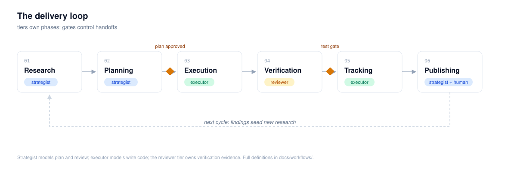

# The delivery loop

Six phases, two gates, three model tiers. The loop is the same whether the
work is a bug fix or a quarter-long effort; only the size of each artifact
changes.

| Phase | Owner | Entry criteria | Exit artifact | Gate to next |
| --- | --- | --- | --- | --- |
| [01 Research](01-research.md) | strategist | a question worth answering | findings doc with citations | open questions resolved or converted to tasks |
| [02 Planning](02-planning.md) | strategist | findings or an approved request | written plan | **plan approved** |
| [03 Execution](03-execution.md) | executor | approved plan, work item created | implementation in a worktree | reviewer request opened |
| [04 Verification](04-verification.md) | reviewer | diff + plan + test evidence | verified diff with evidence | **test gate green** |
| [05 Tracking](05-tracking.md) | executor | every phase transition | tracker state matches reality | tracker current |
| [06 Publishing](06-publishing.md) | strategist + human | verified, tracked work | tagged release + notes | post-release check passes |

## Rules of the loop

1. Phases happen in order. Skipping research to "save time" is how a plan
   solves the wrong problem.
2. The gates are hard. Work does not pass a red gate; see
   [the testing standard](../standards/testing.md).
3. Tracking runs continuously, not at the end: every transition in any phase
   is mirrored to the tracker within the same session that caused it.
4. The loop ends by starting again: publishing a cycle seeds the research
   backlog for the next one.

## How phases map to the hub

- Tiers and model assignments: [models/routing.md](../models/routing.md)
- Methodology skills for planning and execution (Superpowers):
  [superpowers/](../superpowers/README.md). The steps below named after a
  Superpowers skill (brainstorming, writing-plans, test-driven-development,
  and the rest) need Superpowers installed in that harness, per the install
  matrix there; arsenal's own skills work in all four harnesses as cloned.
- Arsenal skills that carry each phase: [skills/](../skills/README.md)
- Tracker commands: [integrations/](../integrations/README.md) and
  `scripts/work-item.sh`

## One feature, from idea to release

[View the illustrated timeline and continuous tracker lane](../assets/feature-delivery-loop.svg)
for **“add CSV export to the reports page”** in a consumer application.
S = strategist, E = executor, R = reviewer. Code analysis belongs to planning;
branch finishing and merge are not extra phases. The example chooses GitHub,
the `csv-export` slug, illustrative research questions and task slices, `main`
as the default branch, and a human merge operator. GitHub issues close on
merge, not merely on a review approval; publishing always needs a human co-sign.

```mermaid
flowchart TB
  subgraph delivery["Developer and agent delivery timeline"]
    idea["Human supplies idea; E captures user story<br/>Add CSV export to the reports page<br/>scripts/work-item.sh create ... --type story"]
    research["01 Research · S · research-loop<br/>Fan out 3–6 sub-agents; sources and confidence<br/>Example questions: CSV behavior? Export approach? Test coverage?<br/>Converge: docs/research/csv-export.md<br/>Cited findings, confidence, recommendation; resolve questions or create tasks"]
    analysis["02 Planning · S · code analysis first<br/>Read findings and relevant application code paths yourself<br/>Existing reports page and its tests"]
    plan["S · brainstorming → writing-plans<br/>planner-executor-handoff → docs/plans/csv-export.md<br/>Work-item ID, goal/non-goals, context, test plan, risks and rollback<br/>Example tasks: CSV generation; reports-page integration<br/>Session-sized; each has acceptance criteria, tests and assigned tier"]
    approved{"HARD GATE 1 · plan approved?<br/>Human or second strategist reviews against research<br/>Right problem, testable criteria, rollback, viable task sizes<br/>Approval on work item before code"}
    execute["03 Execution · E · approved plan read in full<br/>using-git-worktrees + executing-plans<br/>Isolated worktree; feature branch gh-&lt;n&gt;-csv-export<br/>test-driven-development: failing test → smallest change → refactor<br/>One logical task per Conventional Commit; stamp work-item ID<br/>Each commit builds and passes make test-unit"]
    handoff["E · test-gate before verification request<br/>make test-unit + make test-integration<br/>Diff, green local gates, handoff note: built, deltas, reasons, probes<br/>Open PR linked to the issue"]
    verify["04 Verification · independent R · test-gate<br/>verification-before-completion; code review<br/>Clean checkout: rerun make test-unit + make test-integration<br/>Audit skips; behavior tests fail without change; read every changed line<br/>Check plan, tests, correctness, security, maintainability, docs<br/>Artifact: outputs, skip count, findings, verdict; approval on PR with ID"]
    green{"HARD GATE 2 · test gate green?<br/>Both suites exit 0; no tests bypassed to get green<br/>Findings fixed or waived in writing by a human with reason"}
    fix["E · systematic-debugging<br/>Attach failing case; fix and rerun<br/>Flaky stays red until fixed; prove and fix environment failures"]
    revise["S · review findings feed back into plan<br/>Scope changes, disputes, or E stuck twice<br/>Comment evidence; revise plan and seek reapproval"]
    merge["finishing-a-development-branch<br/>Feature branch → PR → main<br/>PR: what, why, tests, ID, risks; squash review fixups<br/>Human merges only with green CI and R approval<br/>Artifact: merged diff; each merged commit builds/tests"]
    publish["06 Publishing · S + human · release-publish<br/>Version bump per consumer policy; changelog and edited notes with IDs<br/>Annotated vX.Y.Z on merge commit; push tag; CI-built artifacts<br/>Human presses publish or approves pipeline<br/>Outside install, endpoint, or smoke check; record on release work item<br/>Artifact: tagged release, notes, post-release evidence; runtime rollback in notes"]
    backlog["Within a day: file follow-ups, review debt, new questions<br/>Artifact: next research backlog"]
    idea --> research --> analysis --> plan --> approved
    approved -->|Approved| execute
    approved -->|Rejected| plan
    execute --> handoff --> verify --> green
    green -->|Failing case| fix --> execute
    green -->|Scope or disputed findings| revise --> plan
    execute -->|Scope change or stuck twice; written attempts| revise
    green -->|Green evidence| merge --> publish --> backlog
    backlog -->|Next cycle| research
  end
  subgraph tracking["05 Tracking · E continuously · work-tracking · same session as every transition"]
    commands["scripts/work-item.sh create / comment / transition / link / pr / show<br/>One item per unit of work; --type story, task, or bug<br/>IDs in branches, commits, PR titles; short factual evidence comments<br/>GitHub: open/closed states; middle states use labels or linked PR"]
    t0["Idea: E creates open issue → backlog"]
    t1["Research: S findings and tracked questions; E links evidence<br/>Planning opens → in-progress label; link plan"]
    t2["Approver records decision; E links plan → ready label"]
    t3["E first commit → in progress; comment changes/evidence<br/>Handoff → in review, open PR linked to issue"]
    t4["R comments outputs, findings, verdict; E keeps state current<br/>Human records any reasoned findings waiver; issue stays open"]
    t5["Human merges; E verifies done/closed<br/>PR closing keyword closes issue"]
    t6["S notes and evidence; human publish approval; E release link<br/>Release notes reference issue; comment post-release check<br/>Create next backlog items"]
    commands --- t0 --> t1 --> t2 --> t3 --> t4 --> t5 --> t6
  end
  idea -.-> t0
  research -.-> t1
  plan -.-> t1
  approved -.-> t2
  execute -.-> t3
  handoff -.-> t3
  verify -.-> t4
  green -.-> t4
  revise -.-> t4
  merge -.-> t5
  publish -.-> t6
  backlog -.-> t6
  classDef gate fill:#fff2cc,stroke:#936600,color:#172b40
  classDef feedback fill:#fcebe6,stroke:#a33728,color:#172b40
  class approved,green gate
  class fix,revise feedback
```

Sources: phases [01](01-research.md), [02](02-planning.md),
[03](03-execution.md), [04](04-verification.md), [05](05-tracking.md),
[06](06-publishing.md); [Superpowers](../superpowers/README.md);
[routing](../models/routing.md); [Git](../standards/git.md),
[testing](../standards/testing.md), [review](../standards/code-review.md);
[integrations](../integrations/README.md) and [GitHub](../integrations/github.md);
skills [research-loop](../../.agents/skills/research-loop/SKILL.md),
[planner-executor-handoff](../../.agents/skills/planner-executor-handoff/SKILL.md),
[test-gate](../../.agents/skills/test-gate/SKILL.md),
[work-tracking](../../.agents/skills/work-tracking/SKILL.md), and
[release-publish](../../.agents/skills/release-publish/SKILL.md).
